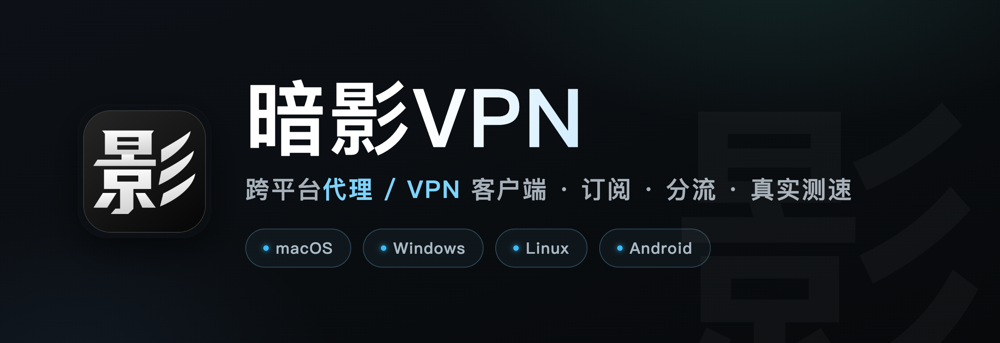

<div dir="rtl">

# ShadowVPN (暗影VPN)

<div align="center">



[简体中文](README.md) · [English](README.en.md) · [繁體中文](README.zh-TW.md) · [Русский](README.ru.md) · **فارسی**

</div>

کلاینت چندسکویی پروکسی / VPN. نسخهٔ دسکتاپ بر پایهٔ Electron (رابط React + Ant Design) و نسخهٔ Android بر پایهٔ Capacitor + VpnService است. هستهٔ اصلی sing-box است و Xray / mihomo بر اساس توانایی هر گره به‌صورت خودکار انتخاب می‌شوند. این پروژه بر پایهٔ FlowZ توسعه یافته است.

## پروتکل‌های پشتیبانی‌شده

**پروتکل‌های پروکسی** (پیوندها / اشتراک‌ها)

- VLESS، VMess، Trojan، Shadowsocks، ShadowsocksR (از طریق mihomo)
- Hysteria2، Hysteria نسخهٔ ۱ (از طریق mihomo)، TUIC، AnyTLS، Snell، Naive
- SOCKS، HTTP، SSH
- سفارشی: JSON خروجی sing-box را جای‌گذاری کنید؛ امکان فعال‌سازی با کاوش روی هستهٔ واقعی تعیین می‌شود

**شبکه‌های mesh**

- WireGuard (از جمله پیوندهای `wireguard://`/`wg://` و ثبت‌نام Cloudflare WARP)، Tailscale

**VPN سازمانی** (دسکتاپ؛ بر پایهٔ پیاده‌سازی‌های رسمی/رایج آپ‌استریم)

- aTrust، EasyConnect — موتور zju-connect
- Cisco AnyConnect، Pulse/Ivanti، Juniper Network Connect، GlobalProtect، F5، Fortinet، Array — موتور OpenConnect
- سازگاری فقط بر اساس آزمون روی درگاه واقعی اعلام می‌شود؛ برای فروشندگان تأییدنشده ادعایی نمی‌شود. مرزها در [enterprise-runtime/COMPATIBILITY.md](enterprise-runtime/COMPATIBILITY.md).

## روش‌های واردکردن

- اشتراک‌ها: Clash YAML/JSON، sing-box JSON، Xray JSON، گروه پیوندهای Base64؛ تشخیص خودکار پیش‌فرض، قابل محدودکردن به یک پروتکل
- پیوندها: `vless` `vmess` `trojan` `hysteria` `hysteria2`/`hy2` `ss` `ssr` `anytls` `snell` `tuic` `naive` `socks5`/`socks` `http(s)` `wireguard`/`wg`
- در صورت شکست بخشی از تجزیه، گره‌های موجود و موارد ناموفق حفظ می‌شوند؛ ترنسپورت‌های ناشناخته هرگز بی‌صدا به TCP تنزل نمی‌یابند

## روش‌های مسیریابی

- **حالت تصرف**: پروکسی سیستمی (پیش‌فرض، بدون تغییر DNS سیستم)؛ کارت مجازی TUN در صورت نیاز قواعد برنامه/فرایند فعال می‌شود یا می‌توان آن را اجباری کرد؛ تصرف DNS سیستمی در TUN جداگانه قابل خاموش‌کردن است
- **تقسیم هوشمند**: کشور/منطقهٔ IP خروجی به‌صورت خودکار تشخیص داده می‌شود — مقصدهای هم‌منطقه مستقیم و بقیه از پروکسی می‌گذرند؛ در صورت شکست تشخیص، پروکسی
- **تقسیم براساس برنامه**: برای هر برنامهٔ نصب‌شده یا فرایند — پروکسی / مستقیم / مسدود / گره مشخص
- **قواعد سفارشی**: دامنه، IP CIDR و GeoIP با بارگذاری گرم بدون قطع اتصال

## امکانات اصلی

- انتخاب خودکار چند هسته‌ای: sing-box تصرف/مسیریابی/DNS/آمار را انجام می‌دهد؛ Xray برای XHTTP/SplitHTTP؛ mihomo برای افزونه‌های Clash
- اتصال یک‌کلیک VPN سازمانی: تشخیص درگاه → ورود فرم/OAuth → تونل → منابع درگاه به‌صورت SOCKS محلی پروجکت می‌شوند
- سنجش تأخیر واقعی از طریق پروکسی با درخواست HTTPS، تفکیک مراحل TCP/TLS/HTTP؛ قابل‌دسترس‌بودن پورت TCP هرگز به‌عنوان کارکرد گزارش نمی‌شود
- به‌روزرسانی خودکار اشتراک‌ها و جایگزینی خودکار گره (کاوش HTTPS از طریق گره)؛ به‌روزرسانی برنامه با راستی‌آزمایی SHA-256
- زبان‌های رابط: 简体中文 / 繁體中文 / English / Русский / فارسی

## وضعیت پلتفرم‌ها

- **macOS** (arm64 / x64، DMG)، **Windows** (x64، نصب‌کننده و قابل‌حمل)، **Linux** (AppImage / deb)
- **Android**: Capacitor + VpnService با هستهٔ sing-box جاسازی‌شده
- VPN سازمانی و هسته‌های سازگار Xray/mihomo پیاده‌سازی دسکتاپ هستند

## توسعه و راستی‌آزمایی

</div>

```sh
npm ci
pnpm --dir web install --frozen-lockfile
npm run build:helper
npm run fetch:core
npm run fetch:dashboard
npm test -- --runInBand
npm run test:core-gate
npm run lint
npm run typecheck:renderer
pnpm --dir web check
npm run build
npm run dev
```

<div dir="rtl">

`npm run dev` نسخهٔ محلی توسعه (Vite + Electron) را با بارگذاری گرم رابط اجرا می‌کند؛ تغییرات فرایند اصلی و preload به راه‌اندازی مجدد نیاز دارند. راستی‌آزمایی اشتراک‌های واقعی از فایل‌های خصوصی خارج از مخزن استفاده می‌کند:

</div>

```sh
SHADOW_VPN_SOURCE_FILE=/absolute/private/config.json \
SHADOW_VPN_REPORT=/absolute/private/report.json \
node scripts/verify-live-backend.cjs
```

<div dir="rtl">

URL اشتراک‌ها، اعتبارنامه‌ها، داده‌های کاربر و گزارش‌ها را هرگز در مخزن کامیت نکنید.

## مجوز و منشأ

[MIT](LICENSE.txt). مبنای آپ‌استریم `e0902e8c9aa8a0baa60ae840d5582edd49781b01` (FlowZ 4.3.3)؛ مرجع: [README.upstream.md](README.upstream.md). سورس و مجوزهای enterprise-runtime: [enterprise-runtime/](enterprise-runtime/README.md).

</div>
